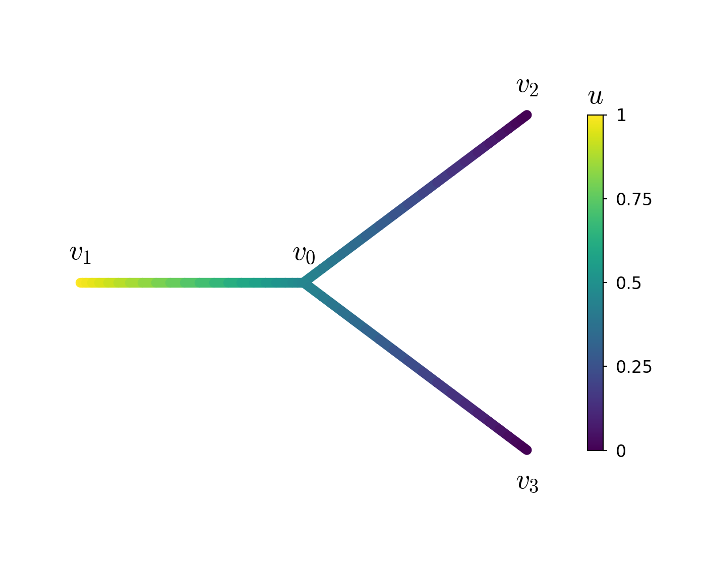
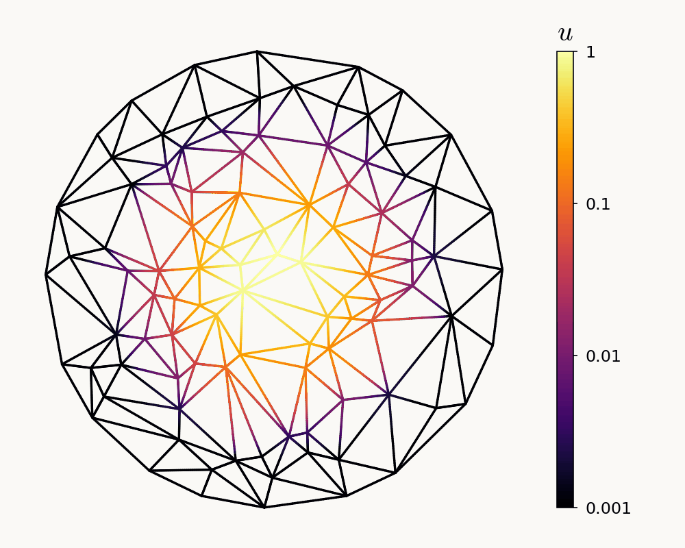
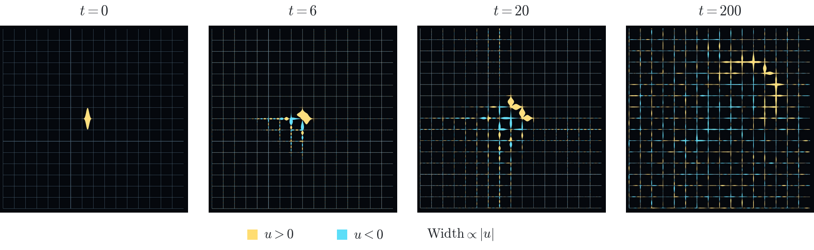

# Dedalus on Networks

A research fork of [Dedalus](https://github.com/DedalusProject/dedalus) for
solving partial differential equations on physical networks. Edges use spectral
bases and are coupled through vertex values and flux conditions.

The network-calculus interface provides graph differential operators and
automatic tau assembly. The solver supports linear and nonlinear boundary-value
problems, initial-value problems and selected eigenvalue problems, with MPI
distribution and Dirichlet-to-Neumann solvers.

This repository accompanies *A scalable computational framework for PDEs on
physical networks* (2026, in preparation), by Sidney Holden, Keaton J. Burns,
Daniel Lecoanet, Jeffrey S. Oishi, Benjamin P. Brown, and Geoffrey M. Vasil.
It includes example scripts and data for reproducing the paper's figures.

[Installation](INSTALL.md) · [Paper examples](paper/README.md) ·
[Reproduce the figures](paper/REPRODUCING.md) ·
[Download the release](https://github.com/sidneyholden1/dedalus-networks/releases/tag/paper-companion-20261106.1)

The Python package remains `dedalus`; install this fork in a separate environment.

## Examples

<table align="center">
  <tr>
    <td align="center" valign="top">
      <h3>Three-edge Poisson</h3>
      
      
A boundary-value problem at one junction.

      <a href="examples/lbvp_network_poisson">Run the example</a>
    </td>
    <td align="center" valign="top">
      <h3>Heat diffusion</h3>
      
      
A hot spot spreads through a network.

      <a href="examples/ivp_network_grid_heat">Run the example</a>
    </td>
  </tr>
</table>

### KdV on a periodic lattice

  <picture>
    <source media="(prefers-color-scheme: dark)" srcset="docs/pages/examples/images/network_kdv_readme_dark.png" />
    
  </picture>

A localized pulse propagates and disperses across a periodic network.

[Example script and equations](paper/kdv/README.md) ·
[Full figure](paper/data/kdv/published.pdf)

---

[Network API guide](docs/pages/network_problems.rst) ·
[Development and tests](NETWORK_DEVELOPMENT.md) · [Citation](CITATION.cff)

Built on [Dedalus](https://github.com/DedalusProject/dedalus), developed by the
Dedalus collaboration. This research fork is maintained independently.

[Upstream documentation](https://dedalus-project.readthedocs.io) ·
[Dedalus citation](CITATION_UPSTREAM.cff) · [License](LICENSE.txt)
