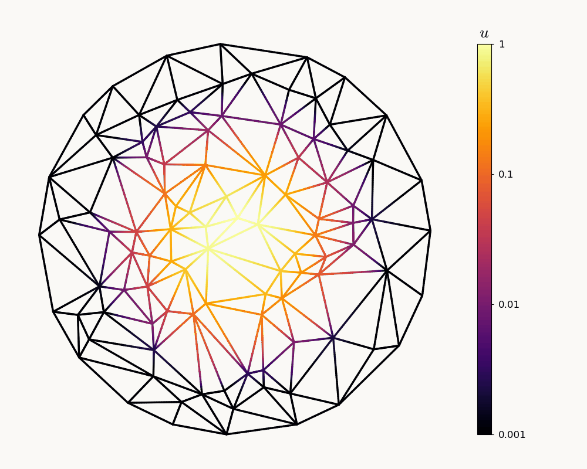

# Heat diffusion on a triangulated disc

A central hot spot spreads through a random Delaunay triangulation with
100 vertices: 20 on a circular boundary and 80 in the interior. A fixed seed
makes the geometry reproducible. Rod lengths equal their geometric lengths.
Dedalus solves `∂t u = ∂s² u` on each rod with continuous temperature and zero
net outward flux at every junction. The network is insulated: total heat stays
constant while temperature differences decay.



From the repository root, in the environment containing this fork:

```console
python examples/ivp_network_grid_heat/heat.py --output output/disc_heat
```

This saves 121 actual simulation states in `snapshots/snapshots_s1.h5`, then
renders `network_disc_heat.gif` and initial, spreading and final PNGs. The
animation uses the same logarithmic inferno colour scale throughout, from
0.001 to 1, to keep the cooler spreading front visible. Temperatures at or
below 0.001 share the lowest colour. A colour bar on the right spans the
network's height, with `u` above it. Colours follow the spectral solution
along the rods; the network has no vertex labels, axes or time readout.

The output directory also contains `run.json` (geometry and parameters),
`checks.json` (numerical checks), and `animation_receipt.json` (frame times,
playback timing and colour scale).

The default solve uses 16 Chebyshev modes per rod, SBDF2 time stepping, and the
Dirichlet-to-Neumann solver. `checks.json` records independent quadrature of
total heat and squared temperature, reconstructed junction conditions, and
temperature bounds. Integrals and derivatives use the physical rod lengths.
`run.json` records the numerical parameters, seed, geometry and triangles.

Initial vertex temperatures sample a Gaussian hot spot. Cubic interpolation
along each rod has zero endpoint derivatives, so the initial field satisfies
both continuity and Kirchhoff flux balance on the irregular network.

To regenerate the animation without solving again:

```console
python examples/ivp_network_grid_heat/plot_heat.py output/disc_heat
```

Use `--no-render` to save only the simulation and checks. Use a different output
directory to keep previous results; rerunning the solve overwrites that run.
`--geometry square` selects the earlier 5 × 5 grid. To reproduce its original
discretization, also use `--modes 20 --timestep 0.005 --stop-time 2`.
