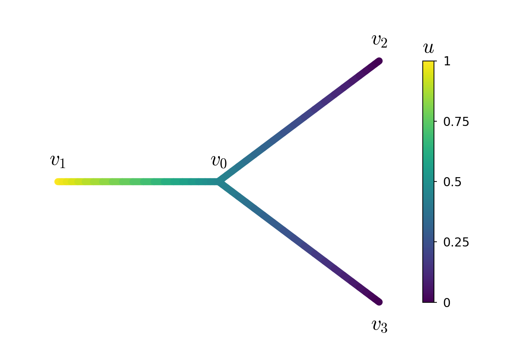

# Poisson equation on a three-edge network



The central junction is `v_0`; the leaves are `v_1` on the left, `v_2` above
and `v_3` below. The directed edges `v_1` to `v_0`, `v_0` to `v_2` and
`v_0` to `v_3` have lengths 1, 1.5 and 2. Each edge solves `-u_xx = 0`,
with `u(v_1)=1`, `u(v_2)=u(v_3)=0`, and continuity and Kirchhoff flux balance
at `v_0`. The analytic check gives `u(v_0)=6/13`.

From the repository root, with this fork installed:

```console
mkdir -p output/poisson
(cd output/poisson && python ../../examples/lbvp_network_poisson/poisson.py)
```

This writes `network_poisson.png` and
`network_poisson/network_poisson_s1.h5` inside `output/poisson`. The HDF5 file
contains edge values `u`, vertex values `U`, and network metadata. Vertex
arrays use the order `("v_0", "v_1", "v_2", "v_3")`.

The plot uses a fixed linear colour scale from 0 to 1, with `u` above the
colour bar. Use a fresh output directory to retain earlier results. For an
MPI run, prefix the Python command with `mpiexec -n 4`; rank zero writes
the gathered output and plot.
